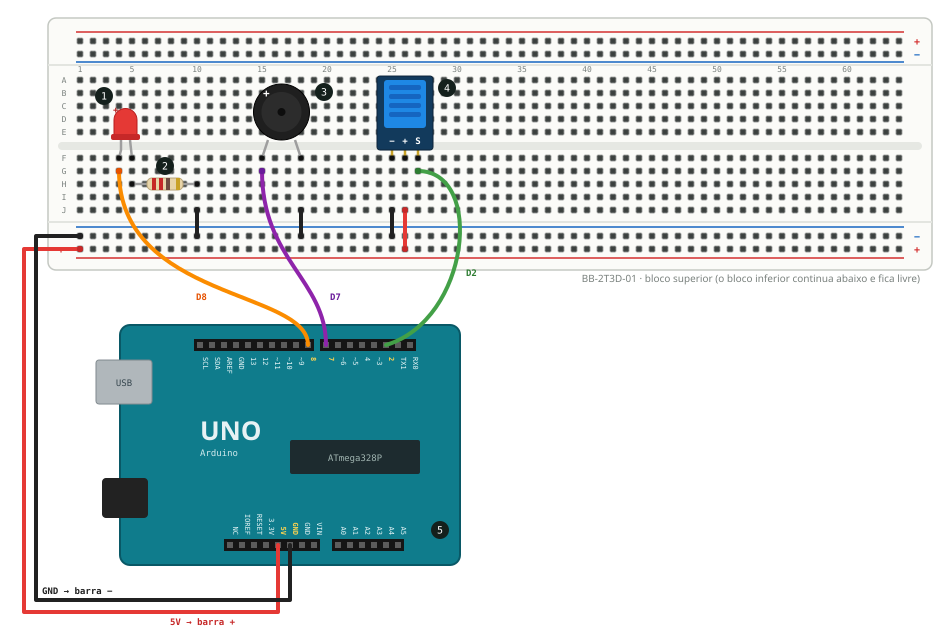
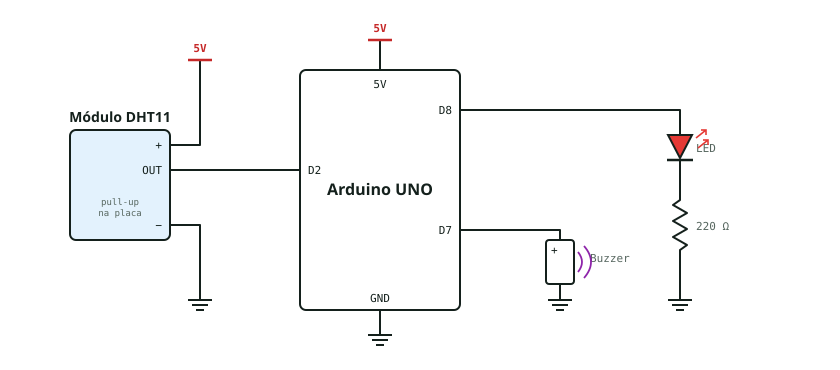

# Monitor de Clima com Arduino

Protótipo de IoT feito para a disciplina de Internet das Coisas. Um Arduino UNO lê temperatura e umidade com um sensor DHT11, envia as leituras para o computador pela USB e dispara um alarme quando a temperatura passa do limite: um LED vermelho acende e um buzzer apita uma vez por segundo.

## Como funciona

- Lê temperatura e umidade a cada 2 segundos.
- Envia os dados no formato `Nome:valor`, que aparece como texto no **Monitor Serial** e como gráfico no **Plotter Serial** da Arduino IDE:
  ```
  Temperatura:23.0 Umidade:55 Limite:22.0 Alarme:1
  ```
- O alarme **liga a partir de 22 °C** e só **desliga a 21 °C**. Essa folga (histerese) evita que o LED e o buzzer fiquem liga-desliga quando a temperatura oscila perto do limite.
- Ao ligar, o LED pisca e o buzzer dá dois bipes curtos, para testar a montagem.
- Se o sensor não responder, o programa mostra no Monitor Serial a causa provável (sensor sem energia ou fio de dados no lugar errado).

## Componentes

| Qtd | Componente |
|---|---|
| 1 | Arduino UNO + cabo USB |
| 1 | Protoboard BB-2T3D-01 (1580 pontos) |
| 1 | Módulo DHT11 de 3 pinos (marcado `− + S`) |
| 1 | Buzzer 5 V |
| 1 | LED vermelho 5 mm |
| 1 | Resistor 220 Ω (vermelho, vermelho, marrom) |
| ~10 | Jumpers |

O módulo DHT11 já tem o resistor de pull-up na plaquinha, então não precisa de resistor extra.

## Ligações

| Componente | Pino | Liga em |
|---|---|---|
| DHT11 | `−` | GND |
| DHT11 | `+` | 5V |
| DHT11 | `S` | pino digital **2** |
| LED | perna longa (+) | pino digital **8** |
| LED | perna curta (−) | resistor 220 Ω → GND |
| Buzzer | `+` | pino digital **7** |
| Buzzer | `−` | GND |

Na protoboard, cada pino e o fio que liga nele precisam estar **na mesma coluna e do mesmo lado do canal central**: as metades A–E e F–J não se conectam.

### Diagrama de montagem



### Esquema elétrico



## Como rodar

1. Instale a [Arduino IDE 2](https://www.arduino.cc/en/software).
2. Em **Ferramentas → Gerenciar Bibliotecas**, instale **DHT sensor library** (Adafruit) e aceite instalar junto a **Adafruit Unified Sensor**.
3. Abra `MonitorClima/MonitorClima.ino`.
4. Selecione **Ferramentas → Placa → Arduino Uno** e a porta do Arduino.
5. Clique em **Carregar**.
6. Abra o **Monitor Serial** em **9600 baud** ou o **Plotter Serial** para ver o gráfico.

Os limites, os pinos e o som do bipe ficam no bloco `CONFIGURACOES` no topo do código.

## Simulação no Wokwi

A pasta [`wokwi/`](wokwi) tem o mesmo projeto pronto para o simulador [Wokwi](https://wokwi.com). Crie um projeto novo de Arduino UNO e cole o conteúdo de `sketch.ino`, `diagram.json` e `libraries.txt` nas abas de mesmo nome. Como o Wokwi não tem o DHT11, a simulação usa o DHT22, que funciona igual. Com a simulação rodando, clique no sensor para mudar a temperatura e disparar o alarme.

## Estrutura

```
MonitorClima/MonitorClima.ino   código para o Arduino UNO
wokwi/                          versão para o simulador Wokwi
docs/                           diagrama de montagem e esquema elétrico
```
